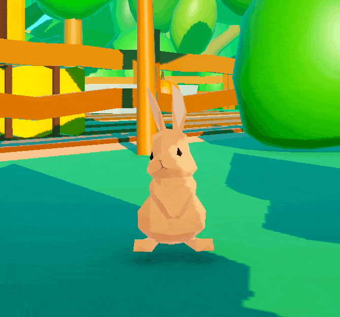

# 🐰 Bad Bunny Day

-black?style=flat&logo=unity)


> 🏆 **Game Jam Project**
>
> Проект разработан командой **DreamTeamForNow** в рамках геймджема **ВШЭ II** (декабрь 2025).
>
> **Команда:**
> *   **Кувико Даниил (fuheshka)** — Team Lead, Game Design, Gameplay & Systems Programming
> *   **Хара Андрей** — Lead Developer
> *   **Шевченко Никита** — Level Design
> *   **Каруна Вадим (somacruz799)** — Art, UI/UX

**Bad Bunny Day** (*Chungus Bunny Day*) — это динамичная 3D стелс-аркада с элементами комедии от третьего лица на **Unity 6**. Вы играете за наглого зайца, которому предстоит съесть как можно больше овощей на фермерском огороде, вовремя донести добычу до сундука и не попасть под пулю разъяренного фермера.

---

## 📸 Скриншоты
| Под прицелом фермера | На ферме |
|:---:|:---:|
|  |  |

---

## 🎮 Геймплей и Особенности

*   **Жадность (Risk vs. Reward):** Съеденные овощи не сразу идут в зачет. Чем больше заяц ест, тем сильнее он толстеет, замедляется и становится более легкой мишенью.
*   **Банкинг очков:** Накопленные очки нужно донести до сундука-зоны (`BankZone`), чтобы сбросить лишний вес и зафиксировать счет.
*   **Жировой щит:** Накопленная масса поглощает одно попадание фермера, но при этом сжигает часть накопленных в животе очков и дает кратковременное ускорение для побега.
*   **Уворот и Стелс:** Используйте укрытия и рывок для уклонения, пока фермер готовит выстрел, и следите за индикатором прицеливания.
*   **Визуал и Звук:** Яркий мультяшный Low-Poly стиль, пиксельный аркадный интерфейс, процедурная анимация «желе» (Squash & Stretch) и динамичный саундтрек.

---

## 🕹 Управление

| Действие | Клавиша |
| :--- | :--- |
| Передвижение | `WASD` / `Стрелки` |
| Обзор камеры | `Мышь` |
| Прыжок | `Space` |
| Рывок (уворот) | `Left Shift` |
| Есть овощи / Сдать очки в сундук | `E` *(удержание)* |
| Пауза / Настройки | `Esc` |

---

## 🛠 Технический стек и Архитектура

*   **Движок:** Unity 6 (`6000.2+` / проверено на `6000.6.4f1`), Universal Render Pipeline (URP), Input System.
*   **Зависимости и Асинхронность:** `Zenject` (Extenject DI), `UniTask`.
*   **Системы и геймплейный код (`Assets/Scripts/Assembly-CSharp/`):**
    *   `PlayerController` и `ProceduralAnimator` — управление от третьего лица с *Coyote Time*, *Jump Buffer*, *Variable Jump Height*, рывком, системой веса/щита и процедурной Squash & Stretch анимацией.
    *   `Farmer` — AI-логика фермера с патрулированием, реакцией на шум, прицеливанием, очередью индикаторов выстрела и выстрелами по игроку.
    *   `EdibleObject`, `FoodSpawner`, `BankZone`, `ScoreManager`, `LevelTimer` — цикл спавна еды, набора массы, сдачи очков и таймера уровня.
    *   `Waypoint`, `HealthUI`, `StaminaUI`, `ScoreUI`, `TimerUI`, `SettingsManager`, `SettingsMenu`, `PauseManager` — мировые 3D-маркеры, HUD, пауза и настройки громкости/чувствительности.

---

## 🚀 Запуск в Unity

1. Клонируйте репозиторий:
   ```bash
   git clone https://github.com/Fuheshka/Bad-Bunny-Day.git
   ```
2. Откройте папку проекта в **Unity Hub** (Unity `6000.6.4f1` или `6000.2+`).
3. Откройте стартовую сцену `Assets/Scenes/MainMenu.unity` (или `Assets/Scenes/Level1.unity`) и нажмите **Play**.

<details>
<summary>Структура репозитория</summary>

- `Assets/` — сцены, скрипты, префабы, модели, анимации, звуки, шейдеры и плагины (`Zenject`, `UniTask`, `URP`, `InputSystem`).
- `Packages/` и `ProjectSettings/` — конфигурация проекта Unity.
- `Screenshots/` — баннер и скриншоты для README.
- `VSCode_History_Backup/` — архив исходников из истории разработки (вне `Assets/`, не участвует в сборке Unity).

</details>
